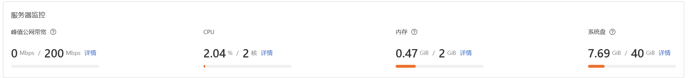

这是我在实际使用了一段时间后，发现的第一版 Z.T.L 实际使用中的一些问题以及一些我觉得可以优化的地方

- 1. 我希望软件名就叫做 Z.T.L，对应 Zero To Lost 的缩写
  - 目的在于将软件定性为一个帮助使用者节约时间、集中散落信息、集中散落事务的“副手性浅度 Agent” 
- 2. 此外，我希望为这个软件配一个比较合适的图标，具体风格和内容还没想好，希望你提一点建议
- 3. 我觉得可以给 Z.T.L 设置一个 “开机自启动” 的开关，这样一个软件还是需要自启动的
- 4. 现在有一个问题，把窗口叉掉，程序会在后台运行，再从后台打开时，窗口会恢复默认大小，应该记录一下关闭时的窗口状态，再打开时恢复
- 5. 窗口收到后台时，那个“关闭秘密卡片”的功能的意图是什么呢？我没有明白，我的设计想法是，秘密卡片在 Z.T.L 失焦后就关闭就可以了
- 6. 现版本下，弹窗有的是 Z.T.L 失焦后会关闭，有的是 Z.T.L 失焦后不会关闭，有的是点级别的地方弹窗会收回，有的是不会收回，类别很乱
  - 统一一下，只有报错类的弹窗是点击窗口外的地方不会收回，其他所有弹窗，均是点击别的地方自动收回
  - 只有秘密的查看弹窗是 Z.T.L 失焦后就关闭，别的窗口不会
  - 注意，Z.T.L 失焦是指点击了 Z.T.L 以外的地方，比如浏览器，这不会引起“点击窗口外的地方”的收回条件
- 7. 将窗口叉掉收到后台，再打开时，将当前页面设置为 home 页
- 8. 现在的 tag 是 DDL 和 Note 共用，把这两个分开吧，每个有各自的 tag 组
- 9. 现在的 tag 只能输入英文，改成也可以输入中文，但是应该对输出的长度有限制，比如 “中文数 * 2 + 英文数不超过 10 个之类的”
- 10. 我想对 DDL 页进行一次比较大的功能扩展，详细如下：
  - 1. 首先，将页面名字改为 calendar，然后整个页面的功能也围绕 calendar 这个含义展开
  - 2. 进入页面的快捷键改为 alt + C
  - 3. 将事务类型扩展为三个基类：DDL/全天标签/区间事务
  - 4. DDL 就是现在的这种类型，一个标题、描述、tag、截止时间、是否循环、是否重要，但是循环要支持高级循环设置(每周的哪几天，循环从何时开始，到何时结束)
  - 5. 全天标签就是一天的一个标签，比如“圣诞节”、“原神版本更新”、“周杰伦新歌发布”，不一定是一个一定要去完成的任务，需要日期、标签内容这些东西，目的在于将一个与日期紧密联系的事情记在 calendar 上，也没什么一定要去干什么的属性，所以是一个标签，当然一天可以有多个标签
  - 6. 区间事务就是字面意义上的，一个“有着时间区间属性、弱化了要完成属性、过了就过了的 DDL”，比如“班会”、“数算期末考试”、“去图书馆学习”这样子的东西，需要一个标题、描述、tag、开始时间、结束时间、是否循环、是否重要，可以跨天、可以重叠，就相当于在日历上画了个圈
  - 7. 关于这些东西要怎么展示，我没有太想好，大体上是在现在的展示框架上进行适配、补充、美化
  - 8. 关于筛选功能，我想把这个筛选做成这样的：支持多关键词(仅限于标题)、多tag(基于常用tag组的一个子组)、是否标星、可划定时间区间的筛选
- 11. 在除了 Home 页外的每个界面，加一个左上角的标题，写这个界面的名字(“Mail”等等)
- 12. 设置里添加邮箱，写名字时不能输入中文
- 13. 我还是希望，我拉取到本地的邮件，直接在 IMAP 上将邮件标记为已读，我的本意就是让我不需要到别的地方去看邮件
- 14. Note 里，我希望实现这样一个功能，因为所有的类型的 Note 都是以卡片的形式展示的，所以我可以“通过拖动卡片的方式来调整卡片之间的顺序”，这样的拖动可以由长时间点击触发，对于已经展开的纸条也会按顺序更改位置
- 15. 书签里，文件书签，可不可以点击后直接打开这个文件呢？就调用 Windows API 直接打开的那种
- 16. 书签里，现在的文件夹书签是，点击后会进入这个文件夹的上一层目录，我希望的是进入这个文件夹的内部目录
- 17. 书签里，网站书签，我希望是可以选择打开的浏览器，比如选择“默认”、“edge”、“chrome”之一
- 18. 邮件和 Note 界面也可以支持我在 10.8 中所说的高级筛选功能
- 19. 还有就是现在的设置界面，你觉得应该去掉/合并/修改/增加那些设置项或者功能按钮呢？提一下你的建议

下面是我对第二版的一些展望

- 20. 可不可以引入一个外部的云服务器？
  - 1. 引入外部云服务器的目的是，如果是一个纯离线本地软件的话，毕竟是会受到设备不能一直开启的影响
  - 2. 引入的外部的轻量的云服务器，比如一个这样的：
  - 3. 这样的云服务器可不可以满足“定时获取天气信息、轮询邮件情况”这样的任务呢？
  - 4. 这样本地的软件端只需要启动时/定期与云服务器端交互就可以维护自身的联网功能
  - 5. 这样还有好处就是可以方便扩展接入微信小程序、接一个模型接口、多个设备共享同一份数据资源、多端同步、一端控制多端等功能
  - 6. 还有就是可以方便的引入一些随时间改变的事情，比如“根据季节、天气改变 Home 页的外貌、calendar可以自带节日”等功能
  - 7. 你觉得怎么样？谈谈你的看法
- 21. 可不可以引入一个模型的接口？
  - 1. 比如接入 DeepSeek 的 API
  - 2. 可以让模型自行处理一些事务，比如“制定一个今日事务清单、自然语言化增加日程、浅度规划事务”
  - 3. 这样可以提高 Z.T.L 作为 agent 的综合能力，至于与模型深度聊天工作这种事，就不是 Z.T.L 的能力范围了
- 22. 可不可以为这个软件做一个全套的前端与动效设计？
  - 1. 虽然要走简约风，但是现在的前端也太干巴了，你觉得可以做出那些比较好的前端设计呢？

